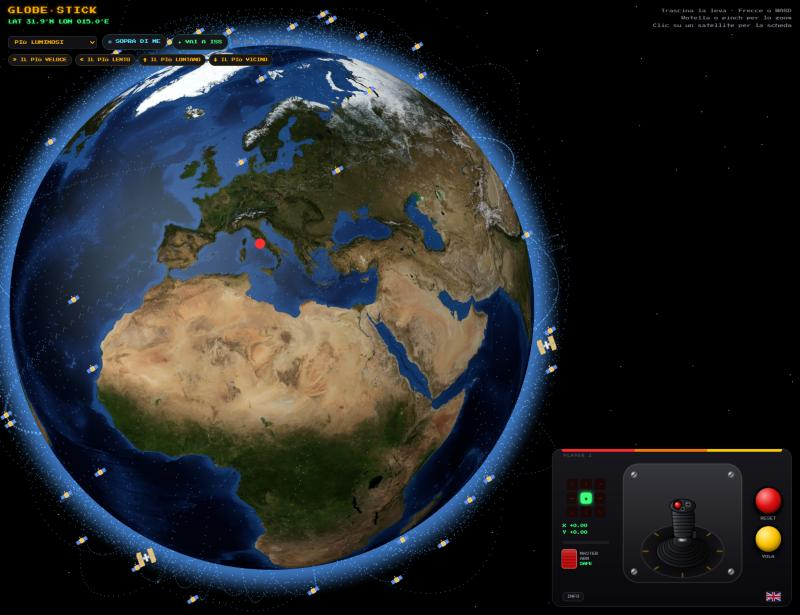
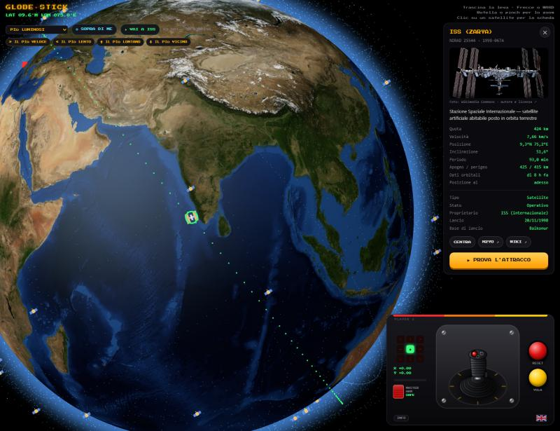
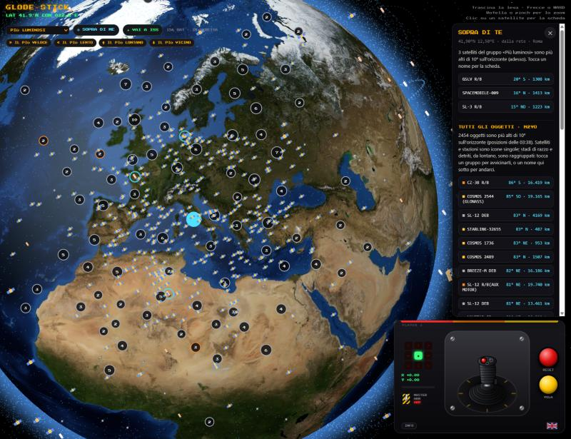
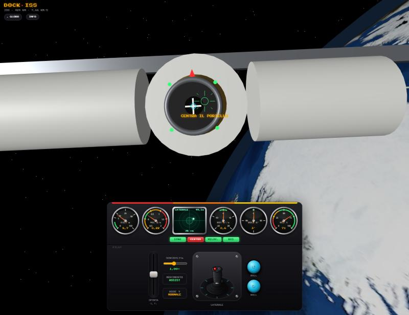
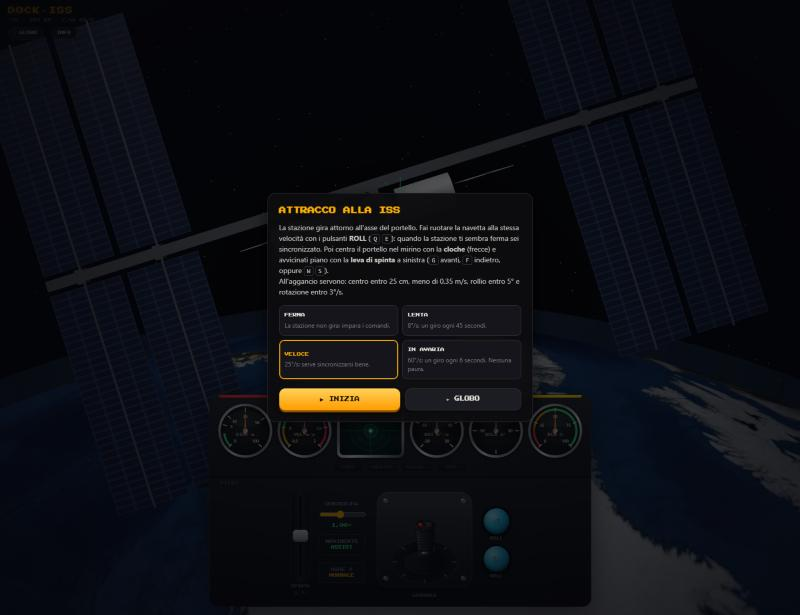
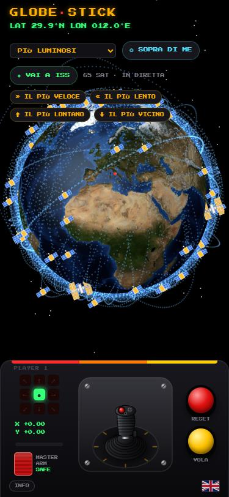
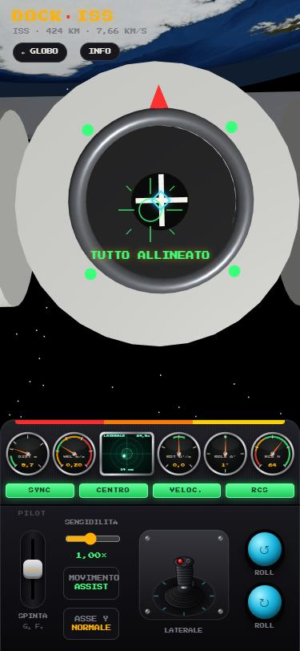

# Globe Stick

[Italiano](README.md) · **English**

A 3D globe with real satellites that you spin with a fighter-jet flight stick, plus a docking mini-game with
the International Space Station. Live at **<https://globe-stick.mrgabri.it>**, phones included, in English and
Italian.



*The screenshots show the Italian interface; flip the flag in the control panel to switch to English.*

## What you can do

- **Spin the globe** with the flight stick (mouse, finger or keyboard) and watch real satellites, updated every
  second, with their orbits: brightest, space stations, weather, GPS, Galileo, geostationary, Starlink.
- **Open a satellite's card**: altitude, speed, orbit, catalog data, photo and Wikipedia article.
- **Jump to the group's records**: the fastest, the slowest, the farthest from and the closest to Earth.
- **See what is above your head** with ABOVE ME, rocket bodies and debris included (MASTER ARM switch).
- **Try docking with the ISS** while it spins.

| The ISS card | Above me, with MASTER ARM armed |
|---|---|
|  |  |

| Docking with the ISS | Docking levels |
|---|---|
|  |  |

| On a phone | |
|---|---|
|  |  |

## Globe controls

| Control | Effect |
|---|---|
| Flight stick (mouse or finger) | left/right spins the globe on its axis, up/down tilts it; the further you push, the faster. Released, it springs back |
| Arrow keys / WASD | same as the stick |
| Wheel / pinch | zoom |
| Red button, `R` | back to Rome |
| Yellow button, `M` | **FLY** mode (up = north, right = east) or **ROTATE** (move the globe as if by hand) |
| Menu, top left | satellite group |
| ◎ ABOVE ME | asks for your location and shows the group's satellites more than 10° above your horizon (cyan rings and list). On the public site it adds, from N2YO, *every* object above you (icons and list; rocket bodies and debris clustered, opening up as you zoom: tap a cluster to zoom in). If the browser gives no precise location, an approximate one from the network can be used |
| MASTER ARM switch | safe (cover closed): only satellites and space stations; armed: rocket bodies and debris too |
| ✦ GO TO ISS, `I` | flies over the ISS and opens its card, with the **TRY DOCKING** button |
| FASTEST / SLOWEST / FARTHEST / CLOSEST | flies to the group's satellite holding that record |
| Flag | switches language; the first time the page follows the browser language |
| ABOUT | credits, intellectual property and privacy ([about.html](about.html)) |
| Click / tap a satellite | opens its card (`Esc` or ✕ closes it); CENTER flies the globe over it |

## Docking with the ISS

[dock.html](dock.html): the station spins around the axis of its docking port and you have to latch on.

- **ROLL** (↺ ↻, `Q` `E`): spin your ship at the station's rate. When you are synchronized the ISS looks still
  and Earth and stars spin around you.
- **Stick** (arrow keys): lateral translation in the ship's frame: if the ship spins, so do the directions.
- **Thrust lever**, on the left (`G` gas / `F` brake, or `W` `S`): forward and back. It springs back to center.
- **Dashboard**: needle gauges for range, closing speed, spin and roll difference and fuel (latching values in
  green), a phosphor scope with your offset from the axis, and SYNC, CENTER, SPEED and RCS lamps.
- **Settings**: sensitivity (0.25–2×), **ASSIST** movement (dampers stop lateral drift and keep closing speed
  under 2 m/s) or **MANUAL** (pure inertia), normal or inverted Y axis.
- **Levels**: still station, 8°/s, 25°/s and "tumbling" at 60°/s.
- **Latch succeeds** if at contact you are within 25 cm of the center, under 0.35 m/s, with roll within 5° and
  spin within 3°/s. Thruster fuel (RCS) is limited.

## How it works

- **Static pages**, no build: [index.html](index.html) (globe), [dock.html](dock.html) (docking),
  [about.html](about.html) (about). Libraries and Earth imagery come from CDNs.
- **Orbits**: orbital elements in OMM (JSON) format from [CelesTrak](https://celestrak.org), positions computed in
  the browser with SGP4 ([satellite.js](https://github.com/shashwatak/satellite-js)). No TLEs: TLE lines have no
  room for NORAD numbers above 99999, already used by recent launches.
- **Updates**: for groups up to 2000 satellites positions are recomputed every second; for larger ones, like
  Starlink, every 10 minutes. Dotted orbits are recomputed every 10 minutes and rotate with Earth in between.
- **Site API** ([api/server.py](api/server.py), Python standard library only):
  - `/api/gp/<group>` and `/api/satcat/<group>`: a copy of CelesTrak's data, downloaded at most every 2 hours
    (the catalog once a day) and served to every visitor. CelesTrak answers 403 to an IP that downloads a group
    again before it is updated, so without the copy people sharing an IP would get no data.
  - `/api/above`: proxy for the [N2YO](https://www.n2yo.com/api/) "What's up?" API. The key stays on the server;
    answers are cached for 2 minutes per point rounded to half a degree, with a cap of 90 calls per hour (N2YO
    allows 100), 6 requests per minute per visitor, from the site's page only.
- **Locally**, just double-click `index.html`: without the API the page asks CelesTrak directly. Fine once in a
  while, not in bursts: CelesTrak blocks the IP.

## Deployment

On the VPS, with Docker Swarm behind Traefik: push a version tag `vX.Y.Z` to GitHub. The webhook queues the
repository and `~/stacks/deploy/deploy.sh` builds the images (`Dockerfile` → `globe-joystick`,
`api/Dockerfile` → `globe-joystick-api`) and updates the [deploy/stack.yml](deploy/stack.yml) stack: nginx with
the pages and the API on `/api/`.

Before the first deployment, create the Docker secret with the N2YO key (typed without echo, kept out of the
shell history):

```bash
ssh -t mrgabri.it 'read -rs N2YO && printf %s "$N2YO" | docker secret create globe_n2yo_api_key -'
```

If N2YO does not answer, or the key is invalid, everything else works: only the full object list is missing.

## Credits

None of these resources is included in the repository: the pages load them while they run.

| Resource | Source | License / terms |
|---|---|---|
| Orbital elements and SATCAT catalog | [CelesTrak](https://celestrak.org) (Dr. T.S. Kelso) | Free use; do not download the same group more than once every 2 hours |
| Objects above a point | [N2YO.com](https://www.n2yo.com) | Personal API key, 100 calls per hour, under N2YO's terms |
| Orbit computation (SGP4) | [satellite.js](https://github.com/shashwatak/satellite-js) | MIT |
| 3D graphics | [three.js](https://threejs.org) | MIT |
| Earth imagery, relief, water | [NASA Visible Earth, Blue Marble](https://visibleearth.nasa.gov/collection/1484/blue-marble), via [three-globe](https://github.com/vasturiano/three-globe) | Public domain (NASA); package MIT |
| Descriptions and links | [Wikidata](https://www.wikidata.org), [Wikipedia](https://www.wikipedia.org) | Wikidata CC0; Wikipedia text CC BY-SA |
| Satellite photos | [Wikimedia Commons](https://commons.wikimedia.org) | Each file has its own license: author and license via the link under the photo |
| Approximate location (optional) | [GeoJS](https://www.geojs.io) | Used only if you choose it |
| Font | [Press Start 2P](https://fonts.google.com/specimen/Press+Start+2P) by CodeMan38, via Google Fonts | SIL Open Font License 1.1 |
| Library delivery | [jsDelivr](https://www.jsdelivr.com) | Free CDN |

In the screenshots on this page Earth is NASA's Blue Marble imagery; the ISS photo in the card comes from
Wikimedia Commons, under the license stated on the file page.

## Intellectual property

- The code is © 2026 MrGabri, under the [MIT license](LICENSE). The project's original artwork, drawn in code,
  is covered too: flight stick, panels, MASTER ARM switch, icons, simplified ISS model, dashboard instruments.
  The screenshots in `docs/img/` belong to the project as well, except for the third-party parts listed above.
- Third-party data, images, text, libraries and fonts remain their owners' property and are used under their
  licenses (see Credits); the MIT license does not extend to them.
- Names and trademarks mentioned (ISS, NASA, ESA, Roscosmos, CNSA, SpaceX, Starlink, GPS, Galileo, CelesTrak,
  N2YO, Wikipedia, Wikimedia…) belong to their owners and only identify objects and sources. The project is not
  affiliated with, endorsed or sponsored by any of them.
- Positions and data are estimates for information and fun: do not use them for navigation, professional
  observation or safety decisions. The mini-game is a simplified simulation.
- To report content you believe infringes your rights, open an
  [issue](https://github.com/MrGabriCavi/globe-joystick/issues).

The full notice, privacy included, is on the [About](https://globe-stick.mrgabri.it/about.html) page.

## License

[MIT](LICENSE) © 2026 MrGabri
