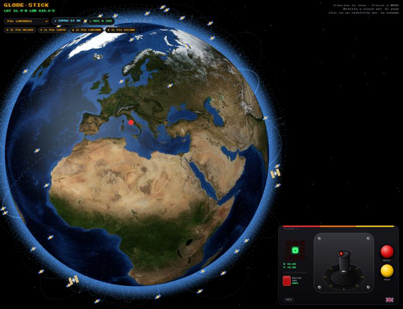
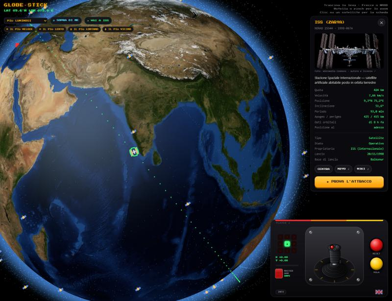
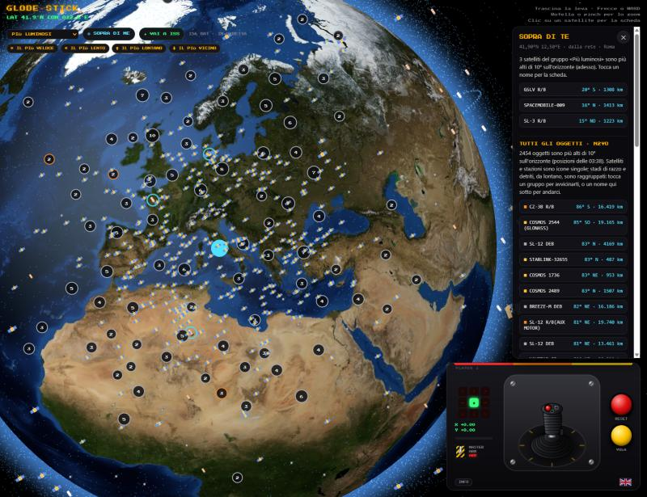
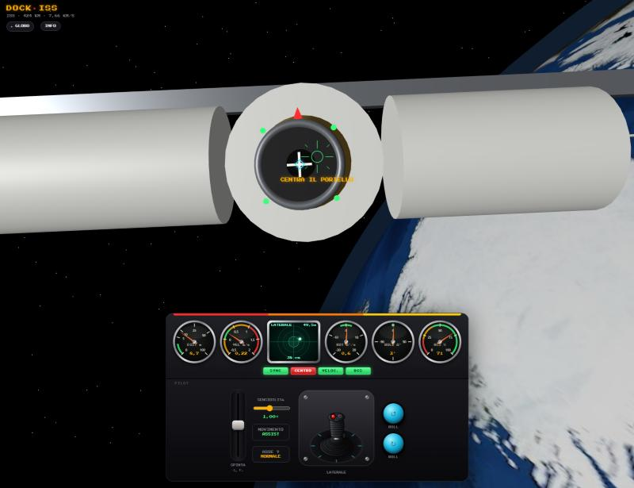
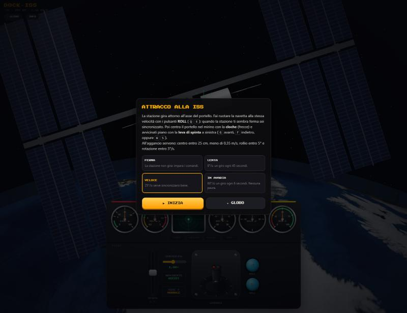
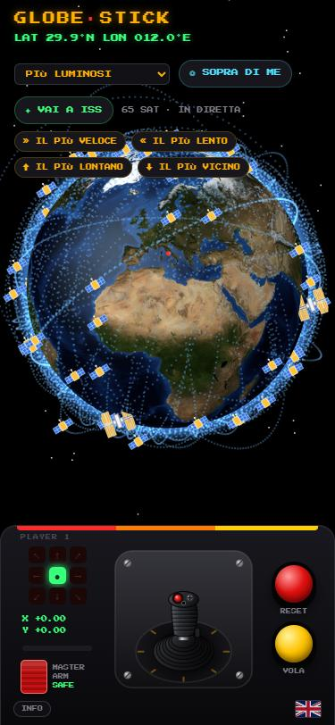
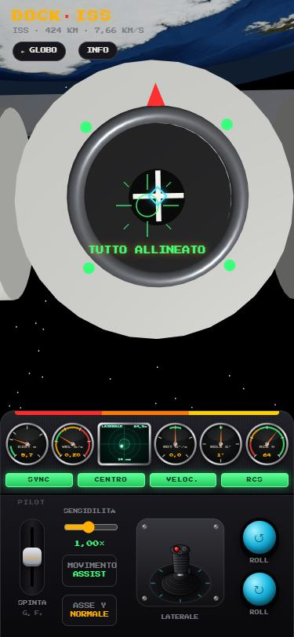

# Globe Stick

**Italiano** · [English](README.en.md)

Un globo 3D con i satelliti veri, da far girare con una cloche da caccia, e un minigioco di attracco
alla Stazione spaziale internazionale. Online su **<https://globe-stick.mrgabri.it>**, anche dal telefono,
in italiano e in inglese.



## Cosa si può fare

- **Girare il globo** con la cloche (mouse, dito o tastiera) e vedere i satelliti veri, aggiornati ogni secondo,
  con le loro orbite: più luminosi, stazioni spaziali, meteo, GPS, Galileo, geostazionari, Starlink.
- **Aprire la schedina** di un satellite: quota, velocità, orbita, catalogo, foto e voce di Wikipedia.
- **Saltare ai record** del gruppo: il più veloce, il più lento, il più lontano e il più vicino alla Terra.
- **Guardare cosa hai sopra la testa** con SOPRA DI ME, compresi stadi di razzo e detriti
  (interruttore MASTER ARM).
- **Provare ad attraccare alla ISS** mentre gira su sé stessa.

| La schedina della ISS | Sopra di me, con MASTER ARM armato |
|---|---|
|  |  |

| Attracco alla ISS | Livelli dell'attracco |
|---|---|
|  |  |

| Sul telefono | |
|---|---|
|  |  |

## Comandi del globo

| Comando | Effetto |
|---|---|
| Cloche (mouse o dito) | sinistra/destra fa girare il globo sull'asse, alto/basso lo inclina; più spingi, più va veloce. Lasciata, torna al centro |
| Frecce / WASD | come la cloche |
| Rotella / pinch | zoom |
| Pulsante rosso, `R` | torna su Roma |
| Pulsante giallo, `M` | modalità **VOLA** (su = nord, destra = est) o **RUOTA** (muovi il globo come con la mano) |
| Menu in alto a sinistra | gruppo di satelliti |
| ◎ SOPRA DI ME | chiede la posizione e mostra i satelliti del gruppo più alti di 10° sul tuo orizzonte (anelli azzurri ed elenco). Sul sito pubblico aggiunge, da N2YO, *tutti* gli oggetti sopra di te (icone ed elenco; stadi di razzo e detriti raggruppati in cluster che si aprono con lo zoom: tocca un cluster per avvicinarti). Se il browser non dà la posizione precisa si può usare quella approssimativa dalla rete |
| Interruttore MASTER ARM | in sicurezza (sportellino chiuso) si vedono solo satelliti e stazioni spaziali; armato anche stadi di razzo e detriti |
| ✦ VAI A ISS, `I` | porta il globo sopra la ISS e apre la sua schedina, con il pulsante **PROVA L'ATTRACCO** |
| IL PIÙ VELOCE / LENTO / LONTANO / VICINO | porta il globo sul satellite del gruppo con quel record |
| Bandierina | cambia lingua; la prima volta la pagina segue la lingua del browser |
| INFO | crediti, proprietà intellettuale e privacy ([about.html](about.html)) |
| Clic / tocco su un satellite | apre la schedina (`Esc` o ✕ la chiude); CENTRA porta il globo sopra il satellite |

## Attracco alla ISS

[dock.html](dock.html): la stazione gira attorno all'asse del portello e bisogna agganciarsi.

- **ROLL** (↺ ↻, `Q` `E`): fai ruotare la navetta alla stessa velocità della stazione. Quando sei sincronizzato
  la ISS sembra ferma e sono Terra e stelle a girare.
- **Cloche** (frecce): spostamenti laterali, nel riferimento della navetta: se la navetta gira, girano anche
  le direzioni.
- **Leva di spinta**, a sinistra (`G` gas / `F` freno, oppure `W` `S`): avanti e indietro. Torna al centro
  quando la lasci.
- **Cruscotto**: strumenti a lancetta per distanza, velocità di avvicinamento, differenza di rotazione e di
  rollio e carburante (in verde i valori buoni per l'aggancio), schermo a fosfori con lo scostamento dal
  centro e spie SYNC, CENTRO, VELOCITÀ e RCS.
- **Regolazioni**: sensibilità (0,25–2×), movimento **ASSIST** (gli smorzatori fermano gli spostamenti laterali
  e tengono l'avanzamento sotto 2 m/s) o **MANUAL** (inerzia pura), asse Y normale o invertito.
- **Livelli**: stazione ferma, 8°/s, 25°/s e «in avaria» a 60°/s.
- **Aggancio riuscito** se al contatto sei entro 25 cm dal centro, sotto 0,35 m/s, con rollio entro 5° e
  rotazione entro 3°/s. Il carburante dei propulsori (RCS) è limitato.

## Come funziona

- **Pagine statiche**, nessun build: [index.html](index.html) (globo), [dock.html](dock.html) (attracco),
  [about.html](about.html) (informazioni). Librerie e immagini della Terra arrivano da CDN.
- **Orbite**: elementi orbitali in formato OMM (JSON) da [CelesTrak](https://celestrak.org), posizioni calcolate
  nel browser con SGP4 ([satellite.js](https://github.com/shashwatak/satellite-js)). Niente TLE: le righe TLE
  non hanno posto per i numeri NORAD oltre 99999, già usati dai lanci recenti.
- **Aggiornamento**: per i gruppi fino a 2000 satelliti le posizioni si ricalcolano ogni secondo; per quelli
  più grandi, come Starlink, ogni 10 minuti. Le orbite a puntini si ricalcolano ogni 10 minuti e intanto
  girano con la Terra.
- **API del sito** ([api/server.py](api/server.py), Python con la sola libreria standard):
  - `/api/gp/<gruppo>` e `/api/satcat/<gruppo>`: copia dei dati di CelesTrak, scaricati al massimo ogni
    2 ore (il catalogo una volta al giorno) e serviti a tutti i visitatori. CelesTrak risponde 403 a un IP
    che riscarica un gruppo prima dell'aggiornamento, quindi senza copia chi condivide l'IP con altri
    resterebbe senza dati.
  - `/api/above`: proxy di [N2YO](https://www.n2yo.com/api/) "What's up?". La chiave resta sul server; risposte
    in memoria per 2 minuti per punto arrotondato a mezzo grado, tetto di 90 chiamate all'ora (N2YO ne
    concede 100), 6 richieste al minuto per visitatore, solo dalla pagina del sito.
- **In locale** basta aprire `index.html` con doppio clic: senza l'API la pagina chiede i dati direttamente a
  CelesTrak. Va bene ogni tanto, non a raffica: CelesTrak blocca l'IP.

## Pubblicazione

Sulla VPS, con Docker Swarm dietro Traefik: si pubblica creando un tag di versione `vX.Y.Z` su GitHub.
Il webhook mette il repo in coda e `~/stacks/deploy/deploy.sh` costruisce le immagini
(`Dockerfile` → `globe-joystick`, `api/Dockerfile` → `globe-joystick-api`) e aggiorna lo stack
[deploy/stack.yml](deploy/stack.yml): nginx con le pagine e l'API su `/api/`.

Prima del primo deploy serve il segreto Docker con la chiave di N2YO (la chiave si digita senza che compaia e
non resta nella cronologia):

```bash
ssh -t mrgabri.it 'read -rs N2YO && printf %s "$N2YO" | docker secret create globe_n2yo_api_key -'
```

Se N2YO non risponde, o la chiave non è valida, il resto funziona: manca solo l'elenco di tutti gli oggetti.

## Crediti

Nessuna di queste risorse è inclusa nel repository: le pagine le caricano mentre girano.

| Risorsa | Fonte | Licenza / condizioni |
|---|---|---|
| Elementi orbitali e catalogo SATCAT | [CelesTrak](https://celestrak.org) (Dr. T.S. Kelso) | Uso gratuito; non scaricare lo stesso gruppo più di una volta ogni 2 ore |
| Oggetti sopra un punto | [N2YO.com](https://www.n2yo.com) | API con chiave personale, 100 chiamate all'ora, secondo i termini di N2YO |
| Calcolo delle orbite (SGP4) | [satellite.js](https://github.com/shashwatak/satellite-js) | MIT |
| Grafica 3D | [three.js](https://threejs.org) | MIT |
| Immagini della Terra, rilievo, mari | [NASA Visible Earth, Blue Marble](https://visibleearth.nasa.gov/collection/1484/blue-marble), via [three-globe](https://github.com/vasturiano/three-globe) | Pubblico dominio (NASA); pacchetto MIT |
| Descrizioni e collegamenti | [Wikidata](https://www.wikidata.org), [Wikipedia](https://www.wikipedia.org) | Wikidata CC0; testi di Wikipedia CC BY-SA |
| Foto dei satelliti | [Wikimedia Commons](https://commons.wikimedia.org) | Licenza propria di ogni file: autore e licenza dal link sotto la foto |
| Posizione approssimativa (facoltativa) | [GeoJS](https://www.geojs.io) | Usata solo se la scegli |
| Carattere | [Press Start 2P](https://fonts.google.com/specimen/Press+Start+2P) di CodeMan38, via Google Fonts | SIL Open Font License 1.1 |
| Distribuzione delle librerie | [jsDelivr](https://www.jsdelivr.com) | CDN gratuita |

Negli screenshot di questa pagina la Terra è l'immagine Blue Marble della NASA; la foto della ISS nella schedina
viene da Wikimedia Commons, con la licenza indicata nella pagina del file.

## Proprietà intellettuale

- Il codice è © 2026 MrGabri, con [licenza MIT](LICENSE). Rientra nella licenza anche la grafica originale del
  progetto, disegnata nel codice: cloche, pannelli, interruttore MASTER ARM, icone, modello semplificato della
  ISS, strumenti del cruscotto. Anche gli screenshot in `docs/img/` sono del progetto, salvo le parti di terzi
  indicate sopra.
- Dati, immagini, testi, librerie e caratteri di terzi restano dei rispettivi titolari e si usano secondo le loro
  licenze (vedi Crediti); la licenza MIT non si estende a questi materiali.
- Nomi e marchi citati (ISS, NASA, ESA, Roscosmos, CNSA, SpaceX, Starlink, GPS, Galileo, CelesTrak, N2YO,
  Wikipedia, Wikimedia…) appartengono ai rispettivi titolari e servono solo a identificare oggetti e fonti.
  Il progetto non è affiliato a nessuno di loro, né da loro approvato o sponsorizzato.
- Posizioni e dati sono stime a scopo informativo e di svago: non vanno usati per navigazione, osservazioni
  professionali o decisioni di sicurezza. Il minigioco è una simulazione semplificata.
- Per segnalare un contenuto che ritieni violi un tuo diritto, apri una
  [issue](https://github.com/MrGabriCavi/globe-joystick/issues).

L'informativa completa, anche sulla privacy, è nella pagina [Informazioni](https://globe-stick.mrgabri.it/about.html).

## Licenza

[MIT](LICENSE) © 2026 MrGabri
